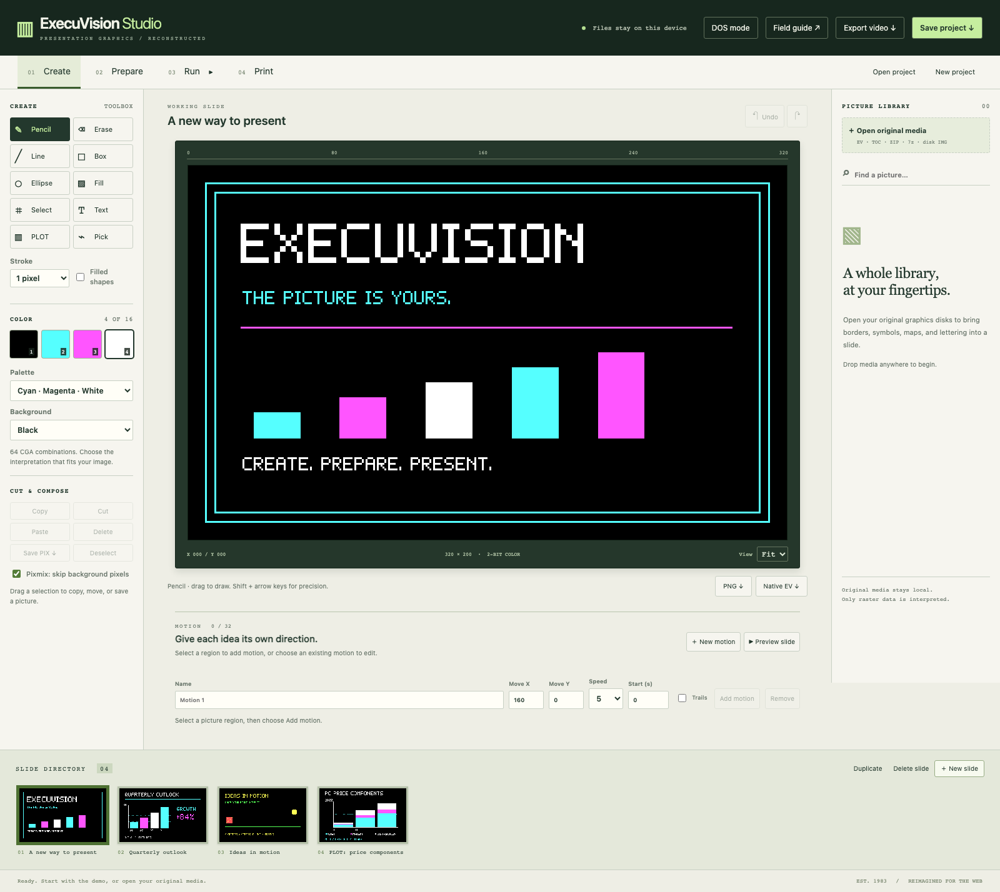
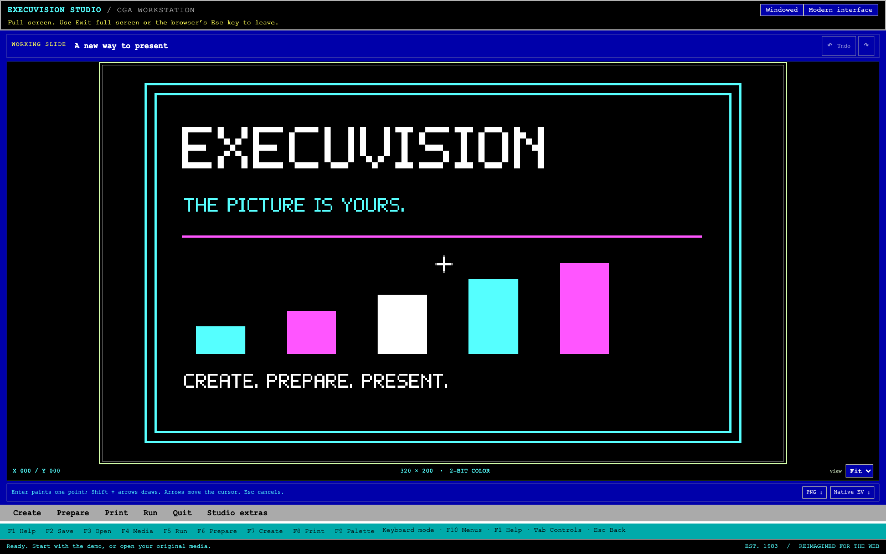

# ExecuVision Studio

[Read the illustrated user guide](https://unamanic.github.io/execuvision-studio/guide/) for step-by-step instructions, fullscreen controls, keyboard reference, and troubleshooting. After `npm run build`, an offline copy is available at `dist/guide/index.html`. In Studio, choose **Field guide → Read the illustrated user guide**.

## The two interfaces

At the opening title screen, press **Enter** for the modern workspace or **D** for the keyboard-operated DOS interface. You can also click either button, or use Tab and Enter to choose. Esc opens the modern editor. The splash appears on each page load, with no countdown or automatic dismissal.

*Modern interface: mouse-operated drawing with controls beside the canvas.*

*Fullscreen DOS interface: keyboard operation, a large canvas, and transient tool windows. Use Tab to reach Enter full screen, then press Enter. Windowed or the browser’s Esc exits fullscreen.*

Both screenshots show the built-in demo. [Capture details](SCREENSHOTS.md).

## Overview

A browser-local work-alike of the presentation graphics workflow described in contemporary ExecuVision reviews and library booklets. This is an independent implementation, not an emulation of the original executable.

Run `npm run build`, then `npm run preview` and open the printed localhost address, or open the built `dist/index.html` directly. The HTML in `src/` needs the generated offline decoder, so build before opening the app. Building and testing require Node.js 24 or newer; no npm package installation is needed unless you want the formatter. Modern Chrome, Edge, Firefox or Safari with WebAssembly and native DEFLATE support is recommended; Chrome and Edge have been exercised interactively; see the validation record.

- Create: 320×200 four-index raster; pencil, erase, line, box, ellipse, flood fill, color picker, ten original text treatments, PLOT for pie/bar/line graphs, including grouped and stacked multi-series bars.
- Cut and compose: rectangular selection, moving, copy/cut/paste, background-skipping Pixmix, native PIX export.
- Media: EV and TOC files, ZIP including nested disk ZIPs, original 7z packages containing EV/TOC or disk ZIPs, raw DOS 1.x 160/320 KiB IMG files. Imported files remain in browser memory and are never uploaded.
- Prepare: name, duplicate, add, delete and reorder slides; forty actions of undo/redo.
- Run: manual/timed slides, seven intervals from 4 seconds to 4 minutes, up to 32 independent straight-line motions per slide with names, nine speeds, start delays and trails, fullscreen.
- Print: slide handouts through the browser's print dialog.
- Save: native EV raster, native PIX fragments, PNG, EV media ZIP and a complete `.evstudio` JSON project.
- Video: MP4 or WebM when supported by the browser, current slide or whole deck, selected timing, up to 1280×800, 15/24/30/60 fps, local recording with progress/cancellation.

Save a project to retain selected palettes, motion, and source metadata. There is no automatic storage; reload/close can discard work. The app warns on closing with edits. Files in this folder include only synthetic demo artwork, not historical clip art.

## PLOT

Choose **PLOT** in the toolbox. Enter one label and one value per line, separated by commas. Pie graphs turn the values into percentages automatically. Bar and line graphs accept up to three value columns; an optional first row names the series. **Try price components** fills a stacked-bar example like the contemporary product illustration.

Click the canvas to place a graph, or first use Select to mark an area, then choose PLOT and **Plot in selected area**. You can combine multiple graphs, captions and library pictures on one slide. Graphs become raster content when placed; undo or generate another plot to revise them.

## Motion

Choose Select and drag around a graphic, then use **Add motion** below the canvas. **New motion** starts a fresh selection without replacing existing motions. Each entry has its own direction (Move X/Y), speed (1 slowest through 9 fastest), start delay in seconds and trails setting. **Preview slide** plays them together.

To edit, click a named entry in the motion list. The app selects its source region and fills its settings; change them and click **Update motion**. You can drag that selected region to move its starting position. **Remove** removes only that motion and leaves the raster artwork; Undo restores it. Later list entries render above earlier ones when they overlap. When using timed Auto run, allow enough slide time for your delays and movements to finish.

Save project now writes version 2, retaining every motion. Projects saved by the earlier single-motion build still open and migrate automatically. The original DOS animation format remains unresolved; EV exports do not contain these motion settings. Multiple motions and precise start delays are implemented as web behavior, not claimed to match original native animation records or timing.

## Video export

Choose **Export video** in the header (also available in Run), select the entire presentation or the current slide, then choose slide time, size, frame rate and an available format. **Extend slides when needed to finish every motion** is enabled by default; it gives the last motion half a second to remain visible. Turn it off to use an exact fixed interval, which can cut off long motions. Click **Create video**, preview the result, then **Download MP4/WebM**.

The video contains only the slide artwork and all its motions, using each slide's selected palette. Upscaling uses crisp integer pixels. Export records in real time and is silent. Keep the tab visible; hiding it cancels recording rather than saving an incomplete video. You can cancel at any time. No microphone, screen-sharing permission, media upload or server encoder is used. Limits are 30 minutes per export and 256 MiB of encoded output. Format availability and actual frame rate depend on the browser and device; MP4 is offered only when supported. The browser may still reject an encoder configuration under resource pressure, in which case choose another format or smaller size.

Implementation uses the existing motion renderer with the browser's [canvas capture API](https://developer.mozilla.org/en-US/docs/Web/API/HTMLCanvasElement/captureStream) and [MediaRecorder format negotiation](https://developer.mozilla.org/en-US/docs/Web/API/MediaRecorder/isTypeSupported_static). Video export is a modern addition, not an original ExecuVision feature. It does not change native EV animation compatibility.

## Compatibility

See [reconstruction notes](../public/RECONSTRUCTION.md). Native files are an experimental interoperability feature. Original palette, object and animation records are unresolved; selected colors and motion are stored in the web project. The original DOS program has not been run to verify new exports.

## Verification

`npm test` checks the codec, raster operations, chart validation, project round trips, TOC numbering, ZIP output and FAT corruption. Run `EVSTUDIO_CORPUS_DIR=/path/to/samples npm run test:corpus` for the optional historical corpus check: all 268 graphics and six disk images, with the Python decoder independently. Set `EVSTUDIO_PYTHON=/path/to/python3` if Node cannot launch the Python on PATH; use the executable appropriate to your environment.

Interactive Chrome checks: original disk import and TOC titles, native image display, selection/copy/paste and undo, slide ordering, and presentation playback. See [QA.md](../QA.md) for the final validation record.

Readable implementation files live in `src/`; `npm run build` combines them with `public/` and the offline decoder to produce `dist/`. GitHub Pages publishes that generated directory. See [the development guide](DEVELOPMENT.md) for the source layout and build process.

## DOS interface mode

Choose **DOS mode** for a separate, keyboard-operated CGA workstation: one fixed-screen canvas, pull-down commands, status line and function-key strip. The **View** menu opens transient toolbox, library, motion and slide windows instead of retaining the modern scrolling panels. F9 opens the palette window.

On the canvas, arrows position the cursor; Enter executes the selected tool. Lines, boxes, ellipses and selections use two Enter presses to mark corners/endpoints. Shift+arrows sketches with Pencil or Erase. Enter places pending pasted artwork. Escape cancels an unfinished selection or shape.

F10 enters menus; arrows navigate, Enter executes, Escape returns focus. F1 shows the command reference. F2 saves, F3 opens a project, F4 opens media, F5 runs, F6 prepares, F7 creates, F8 prints. Tab reaches controls. On Macs, Fn may be needed for function keys. Typing and dialogs retain their normal keys.

Use Tab to reach **Enter full screen**, then Enter to request browser fullscreen. **Windowed** exits; the browser's Escape also exits. Requests are made only on activation, with a visible fallback message if denied or unsupported. **Modern interface** returns to the standard view without losing the current work. No automatic storage or network behavior is added.

Mouse interaction is disabled in DOS mode. Period evidence describes keyboard input, not verified mouse support: [PC Magazine June 11, 1985, p.161](https://books.google.com/books?id=ZFw924nLBSoC&pg=PA161) lists Sources–kb; [March 6, 1984, p.145](https://books.google.com/books?id=ZhoP0KRkQe4C&pg=PA145) describes Shift+arrow drawing and F9 color. Modern mode retains mouse support. This is a keyboard work-alike, not exact original executable emulation; undocumented command sequences and native animation records are not claimed equivalent.
